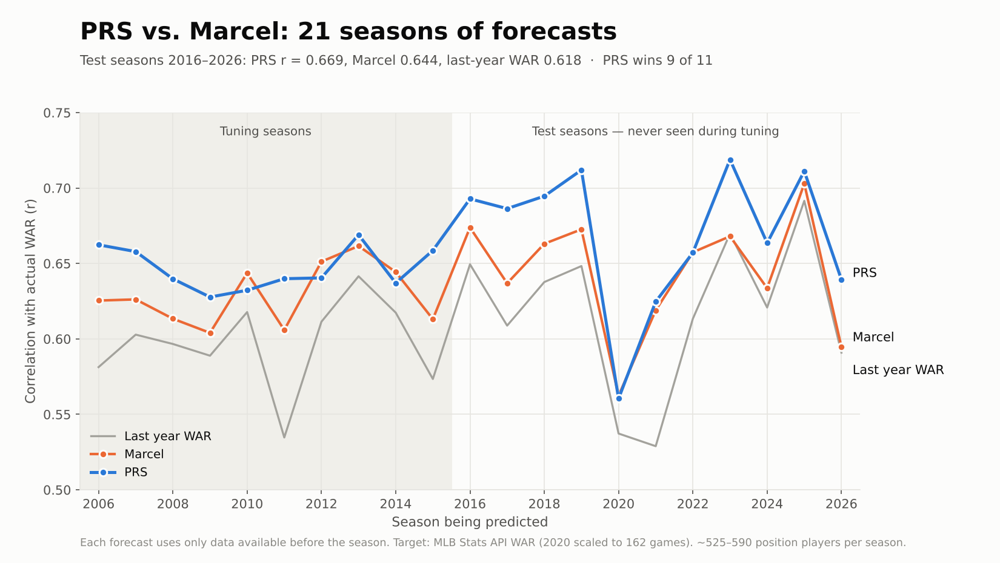
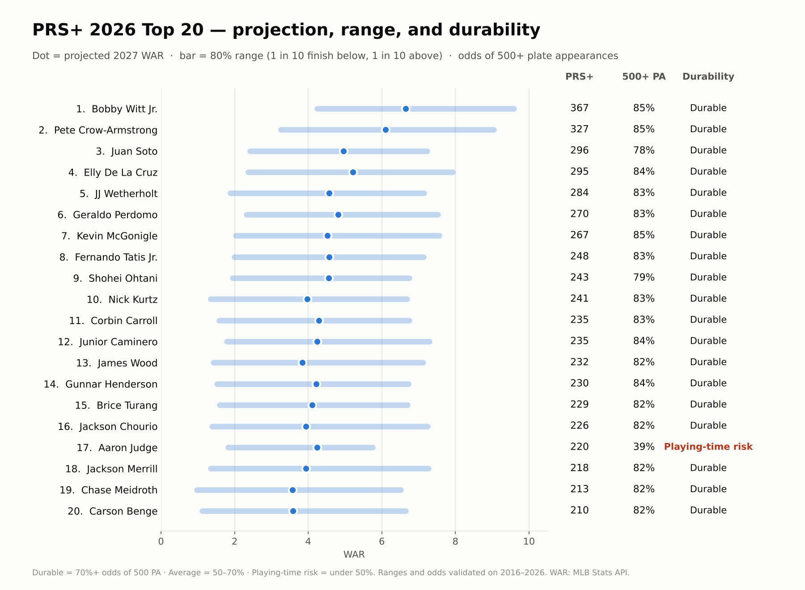
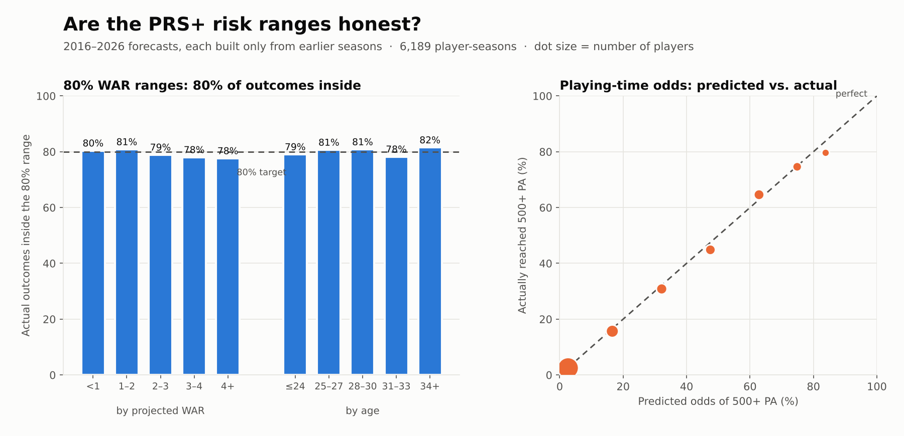
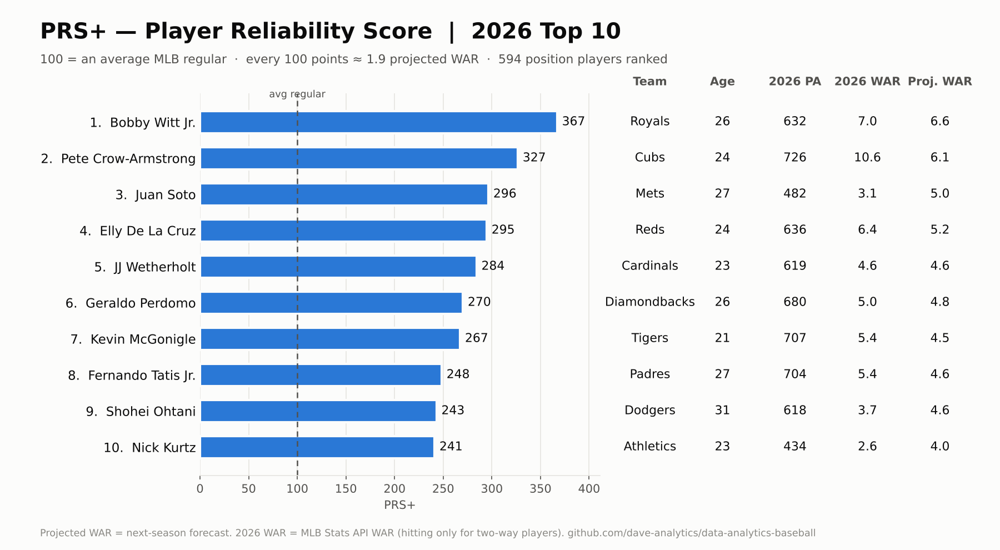
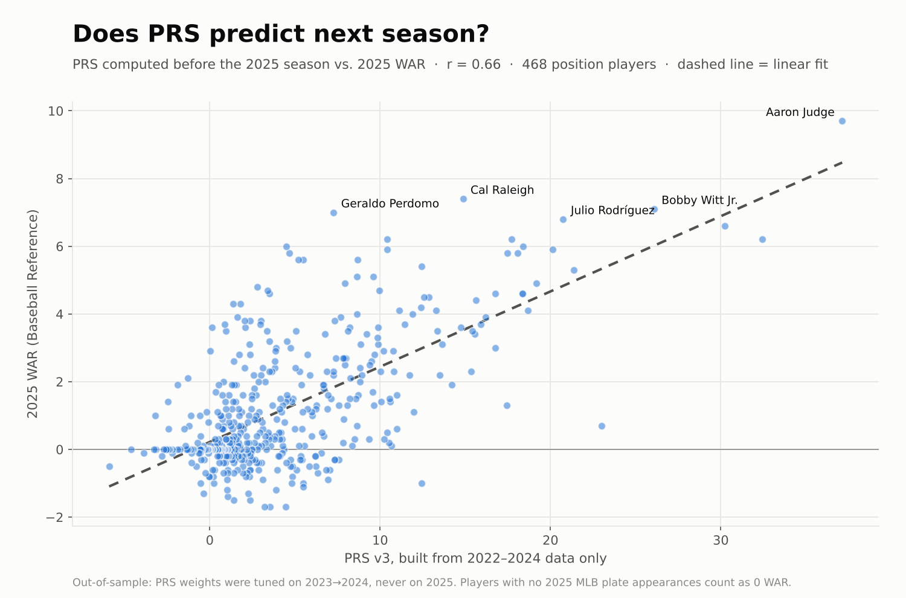
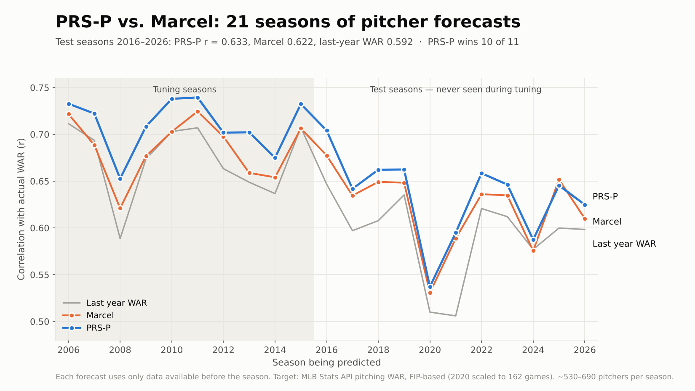
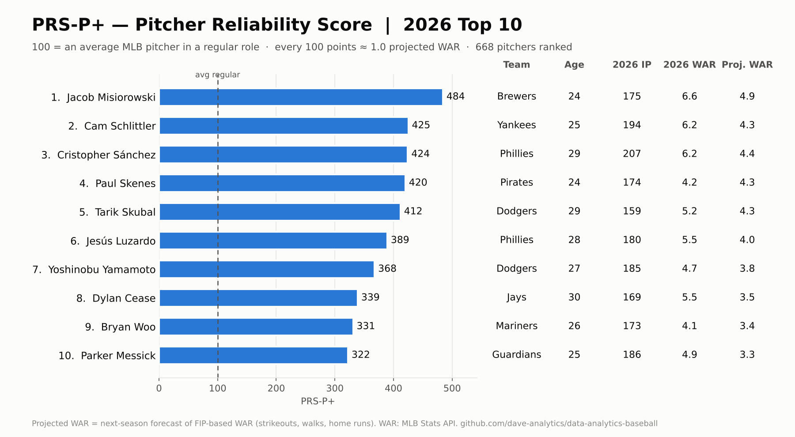
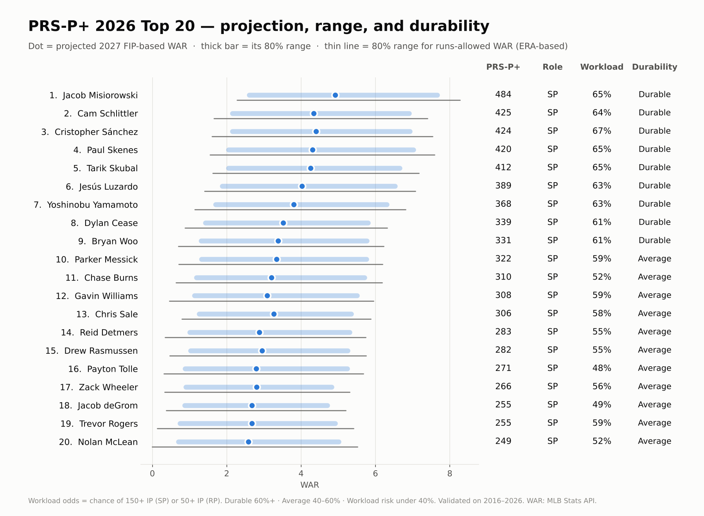
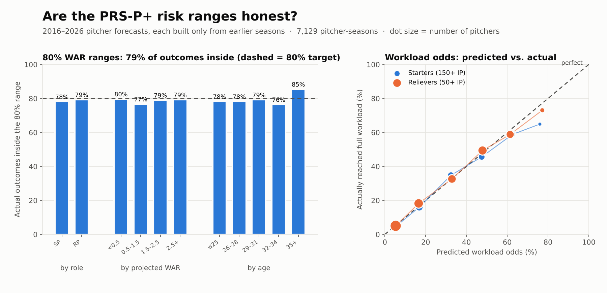

# PRS+ — Player Reliability Score

**An original baseball statistic built from scratch in Python.**

## What Is PRS+?

PRS+ measures how much **total value** you can count on getting from an MLB position player next season — not just how good he is, but how reliably he'll be on the field delivering it.

**How to read it:** 100 = an average MLB regular. 200 = twice the reliable value of an average regular. Every 100 points is roughly **1.9 projected WAR** (100 ≈ 1.9, 200 ≈ 3.8, 300 ≈ 5.6).

Most fantasy baseball and front office metrics measure peak performance. PRS+ measures *dependable* performance. A player who posts elite numbers in 90 games is less valuable than one who posts solid numbers in 155 games. PRS+ quantifies that gap.

## The Core Idea

PRS+ = **how good he is** × **how much he plays**

1. **Hitting** — on-base ability, power, and overall batting value over the last three seasons, plus minor-league performance for young players
2. **Age Curve** — young players improve faster than veterans decline
3. **Base-Running, Defense & Position** — runs added on the bases and in the field, plus credit for playing a harder position
4. **Availability** — how many plate appearances the player has actually delivered over the last three seasons

## Methodology

### Hitting
On-base percentage, home run rate, and total batting runs from the last three seasons, weighted toward the most recent season. For players 27 and under, Triple-A and Double-A stats are blended in after translating them down to MLB level, so a prospect with a short MLB track record isn't judged on a handful of big-league at-bats alone. Each stat is standardized (z-scored) before blending, so every component counts as much as its weight says.

### Age Curve
Players are adjusted by their age during the season (MLB's June 30 convention). The curve is asymmetric: players below their late-20s peak are expected to improve, while veterans decline.

### Base-Running, Defense & Position
Three-season base-running runs, fielding runs, and positional value (a shortstop is worth more than a first baseman with the same bat) from the MLB Stats API, converted to a per-600-plate-appearance rate and standardized.

### Availability
Plate appearances over the last three seasons, weighted toward the most recent. A missed season counts as zero — that's the reliability in Player Reliability Score. Seasons before a player's MLB debut are skipped rather than counted as missed, young players get a bump for the playing time they tend to earn, and projections are capped at a full, healthy season. The shortened 2020 season is scaled to a 162-game pace.

## Validation — 21 Seasons vs. Marcel

PRS+ is tested the hard way: build it using **only data available before a season**, then check how well it predicts that **next** season's WAR. It is compared against **Marcel**, the standard public baseline projection system (Tom Tango), and against simply using last season's WAR.

All settings were tuned on **2006–2015 only**. The **2016–2026** seasons were never seen during tuning.



| Test seasons 2016–2026 (11 seasons) | **PRS+** | Marcel | Last year's WAR |
|---|---|---|---|
| Correlation with actual WAR (r) | **0.669** | 0.644 | 0.618 |
| Average miss (WAR) | **0.86** | 0.89 | 0.93 |
| Within 2 WAR of actual | **88.9%** | 88.3% | 87.7% |
| Top 25 that finished top 25 in WAR | **10.7** | 10.4 | 9.7 |
| Seasons PRS+ beat Marcel (r / average miss) | — | 9 of 11 / 10 of 11 | — |

<sub>~525–590 position players per season with 200+ plate appearances over the prior three seasons. Target: MLB Stats API WAR (2020 scaled to 162 games). Players with no MLB plate appearances the next season count as 0 WAR.</sub>

**Key findings:**
- PRS+ beats Marcel in **9 of the 11 seasons it never saw**, with a smaller average miss in 10 of 11.
- **Availability was the biggest single improvement** over a rate-only score; base-running, defense, and position were next.
- **No age bias.** Marcel underrates players 23 and under by about 0.6 WAR and overrates players 34+ by about 0.35 WAR; PRS+ misses every age group by about the same small amount.
- **Where it's even:** at the very top of the rankings PRS+ and Marcel identify stars about equally well, and neither can foresee true breakouts — players whose past numbers gave no hint of a 6–7 WAR season.

**Blended projection (v7).** The PRS+ index is pure PRS. The *projected WAR* next to it is now **65% PRS + 35% Marcel**, with each converted to WAR using its 2006–2015 fit. The two systems make different mistakes, so the blend is a little steadier than either one alone. On 2016–2026 the blend improved correlation from 0.669 to 0.673 and the average miss from 0.857 to 0.853 WAR, and it beat PRS alone in 8 of 11 seasons. It's a small gain, but a consistent one.

## Risk: Range and Durability

Two players can share the same projection with very different risk. Every PRS+ forecast comes with:

- **An 80% range** for next-season WAR — 1 in 10 players should finish below it, 1 in 10 above. Ranges are sized by projection level, age, MLB experience, and playing-time history, and the downside and upside are sized separately.
- **Odds of 500+ plate appearances** next season, with a **durability label**: **Durable** (70%+), **Average** (50–70%), or **Playing-time risk** (under 50%).



**Are they honest?** Tested on 2016–2026, with each season's ranges and odds built only from earlier seasons:



- **80% of actual outcomes landed inside the 80% ranges** — 78–81% for every projection tier, 78–82% for every age group, and 78–84% in every full season (2020's 60-game season: 70%). Misses are balanced: for players projected 4+ WAR, 12% finished below the range and 11% above.
- **Playing-time odds match reality:** players given 75% reached 500 PA 75% of the time; players given 32%, 31% of the time.
- **Durability separates playing time:** Durable players reached 500 PA 76% of the time and fell under 300 PA only 7% of the time; Average players reached 500 PA 60% of the time; Playing-time-risk players 11%.
- **Injured-list history (v7):** the odds now use each player's last three seasons of injured-list stints from MLB transaction records (2009 on): days missed, 60-day stints, arm injuries, and whether he ended the season still on the IL. For hitters the gain is real but small (better in 9 of 11 test seasons). IL history did **not** improve WAR forecasts, so it's used for playing time only.
- **What it can't do:** durability does *not* predict who underperforms their WAR forecast. Among players with similar projections, Durable and Playing-time-risk players lost 2+ WAR at about the same rate — performance swings are mostly noise. So PRS+ reports a range for performance and odds for playing time, and makes no "volatile vs. steady" performance call the data doesn't support.

### Version history
- **v1** was validated against same-season, partial-year WAR (r = 0.675). That mostly confirmed PRS and WAR were measuring the same two months of hitting, not that PRS predicts anything. Its resilience modifier (OBP before vs. after an absence) didn't improve forecasts and was removed.
- **v2–v4** added availability, defense/base-running/position, and young-player handling, validated on 2024–2026.
- **v5 (PRS+)** re-tuned everything on 2006–2015, added overall batting value, switched to the PRS+ index, and was tested on 11 unseen seasons against Marcel.
- **v6** added 80% WAR ranges, playing-time odds, and durability labels, validated on 2016–2026.
- **PRS-P+** extended the method to pitchers, validated the same way against Marcel, with its own 80% ranges and workload odds.
- **v7 / PRS-P+ v2** blend projected WAR with Marcel (65/35 for hitters, 90/10 for pitchers), add injured-list history to the playing-time and workload odds, and fix ranges that ran too narrow for the top projections. The top tiers are now sized from the most recent five seasons, pooled across ages, because each age group alone had too few stars.

## Sample Output — PRS+, 2026



```
rank  name                 age   PRS+   proj. WAR   80% range    500+ PA   durability
1     Bobby Witt Jr.        26    367      6.6      4.2 – 9.6      85%     Durable
2     Pete Crow-Armstrong   24    327      6.1      3.3 – 9.0      85%     Durable
3     Juan Soto             27    296      5.0      2.4 – 7.2      78%     Durable
4     Elly De La Cruz       24    295      5.2      2.4 – 7.9      84%     Durable
5     JJ Wetherholt         23    284      4.6      1.9 – 7.1      83%     Durable
17    Aaron Judge           34    220      4.2      1.8 – 5.8      39%     Playing-time risk
```

### Does PRS+ predict next season? 2025 forecasts vs. actual


## PRS-P+ — Pitchers

The same idea for pitchers: **how good he is × how many innings he delivers**, on an index where **100 = an average MLB pitcher in a regular role** (the top 300, 10 per team). Every 100 points is roughly **1.0 projected WAR**.

> **Which WAR?** PRS-P+ projects **FIP-based WAR** (the MLB Stats API's pitching WAR), which credits strikeouts, walks, and home runs — the outcomes a pitcher controls — and mostly ignores runs that score on balls in play. It's the standard target for pitcher projections because it's steadier year to year. It is **not** the same as ERA. Paul Skenes in 2026 posted 4.2 FIP-based WAR (12th among pitchers) but only 3.0 runs-allowed WAR (33rd) after his ERA rose from 1.97 to 3.82. That's why every pitcher also gets a separate range for runs-allowed WAR (below).

#### What is FIP?

**FIP (Fielding Independent Pitching)** estimates what a pitcher's ERA *should* have been, using only the outcomes he controls without help from his fielders: **strikeouts** (good), **walks and hit batters** (bad), and **home runs** (very bad).

> FIP = (13 × HR + 3 × (BB + HBP) − 2 × K) ÷ innings pitched + a constant (~3.1)

The constant puts FIP on the same scale as ERA, so a 3.50 FIP reads like a 3.50 ERA. Balls in play are left out because what happens to them depends heavily on the defense, the ballpark, and luck — those swing a lot from year to year, so FIP predicts next season better than ERA does.

| Paul Skenes | ERA | FIP |
|---|---|---|
| 2025 | 1.97 | 2.36 |
| 2026 | 3.82 | 3.33 |

His FIP got worse (home runs doubled, 11 → 20) — a real decline. His ERA got worse by more than FIP explains, partly from balls in play and run timing. FIP-based WAR turns FIP into wins; runs-allowed WAR uses the runs that actually scored, so it tracks ERA.

- **Pitcher quality** — strikeout rate, walk rate, and overall pitching value per batter faced over the last two seasons (pitchers change fast, so the most recent season counts three times as much and older seasons don't help), plus translated minor-league strikeout rates for young arms and an age curve.
- **Availability** — innings over the last two seasons, skipping pre-debut seasons, with a role bonus for starters (who pile up innings).

**Validation:** same protocol as hitters — tuned on 2006–2015, tested on 2016–2026 against Marcel.



| Test seasons 2016–2026 (11 seasons) | **PRS-P+** | Marcel | Last year's WAR |
|---|---|---|---|
| Correlation with actual WAR (r), FIP-based | **0.633** | 0.622 | 0.592 |
| Average miss (WAR) | **0.58** | 0.61 | 0.64 |
| Within 1 WAR of actual | **80.9%** | 79.3% | 78.5% |
| Top 25 that finished top 50 in WAR | **15.8** | 15.1 | 14.5 |
| Seasons PRS-P+ beat Marcel (r / average miss) | — | 10 of 11 / 11 of 11 | — |

<sub>~530–690 pitchers per season with 50+ innings over the prior three seasons. Target: MLB Stats API pitching WAR, which is FIP-based (2020 scaled to 162 games).</sub>

- PRS-P+ beats Marcel for **both starters (r 0.60 vs 0.58) and relievers (0.44 vs 0.38)** — relievers are harder to project for everyone, but that's where PRS-P+ gains the most.
- **Little age bias:** Marcel underrates pitchers 25 and under (+0.17 WAR) and overrates those 35+ (−0.18); PRS-P+ stays within ±0.05 at every age.
- The edge over Marcel is smaller for pitchers than for hitters — pitcher WAR is noisier year to year — but it is consistent: a smaller average miss in all 11 test seasons.
- **Blended projection (v2):** projected WAR is **90% PRS-P + 10% Marcel**. It beat PRS-P alone in all 11 test seasons, though by a small margin (r 0.633 → 0.635). The PRS-P+ index itself is unchanged.



### Pitcher risk: range and workload

Like the hitter version, every PRS-P+ forecast comes with:

- **An 80% range** for next-season WAR, sized by projection, role, age, innings history, and experience (downside and upside separately).
- **Workload odds** — the chance of a full workload next season: **150+ IP for starters, 50+ IP for relievers** — with a durability label: **Durable** (60%+), **Average** (40–60%), or **Workload risk** (under 40%). The cutoffs sit lower than for hitters because even the most durable starters reach 150 IP only about two-thirds of the time.





Tested on 2016–2026, with each season built only from earlier seasons:
- **79% of outcomes landed inside the 80% ranges** — starters 78%, relievers 79%, 77–79% for most ages. Aces projected 2.5+ WAR now land inside 79% of the time (76% before v2), with misses split evenly above and below. One honest gap remains: pitchers 35+ come in at 86% (ranges slightly wide).
- **Workload odds match reality** for both roles — relievers given 48% reached 50 IP 49% of the time; starters given 32% reached 150 IP 35% of the time. Starter innings have been falling for years, so the odds are recalibrated each season on the most recent three, separately for starters and relievers. Honest gap: the few starters given 70%+ odds (about 5 a season) reached 150 IP only about 60–65% of the time — starter workloads have a hard ceiling no model fully captures.
- **Injured-list history (v2)** helps more for pitchers than hitters: workload odds improved in 8 of 11 test seasons. Ending a season on the IL and arm injuries lower the odds most.
- **Durability separates workload:** Durable starters reached 150 IP 61% of the time vs. 18% for Workload-risk starters; Durable relievers reached 50 IP 65% of the time vs. 16%.
- As with hitters, durability predicts **innings, not performance** — it doesn't tell you who will underperform their WAR forecast.

### Runs-allowed range

Because ERA-based results swing more than FIP-based ones, each pitcher also gets an **80% range for runs-allowed WAR** (RA9-WAR — WAR built from the runs that actually scored). It's centered on a runs-allowed projection (same blend, converted to runs-allowed WAR) and sized and tested the same way, and it's about 30% wider than the FIP-based range. In the 2026 top 20 chart above it's the thin line under each bar.

- **2016–2026 test:** 78.9% of runs-allowed outcomes landed inside (starters 79%, relievers 79%). Aces projected 2.5+ WAR: 78% (74% before v2).
- **Judged on runs allowed,** PRS-P+ still edges Marcel over the 11 test seasons (r 0.553 vs. 0.545), though the margin is thin.

### 2026 report card

Preseason 2026 projections, built only from data through 2025, compared with what happened:

| 2026 season | PRS-P+ | Marcel | Last year's WAR |
|---|---|---|---|
| Correlation with FIP-based WAR | **0.625** | 0.610 | 0.598 |
| Correlation with runs-allowed WAR | 0.519 | 0.519 | — |
| Average miss (FIP-based WAR) | **0.55** | 0.60 | 0.61 |
| Inside the 80% range | 79% (FIP-based) · 78% (runs-allowed) | — | — |

- **Hits:** Cristopher Sánchez (projected 4.2, actual 6.2), Tarik Skubal (5.3 → 5.2), Yoshinobu Yamamoto (3.6 → 4.7).
- **Misses:** the preseason #1, Paul Skenes (5.5 → 4.2 FIP-based, 3.0 runs-allowed — just under his runs-allowed floor); injured aces Garrett Crochet (30 IP) and Hunter Greene (28 IP); and young breakouts the model was too cautious on — Jacob Misiorowski (1.3 → 6.6) and Cam Schlittler (1.3 → 6.2).

## Tech Stack

- **Python 3.14**
- **pandas / numpy** — data manipulation, weighting, and backtesting
- **requests** — MLB Stats API calls (no authentication required)
- **MLB Stats API** — MLB and minor-league stats, base-running/fielding/positional run values, WAR, player bios (2003–2026)
- **matplotlib** — charts

## What's Next

- **2027 preseason rankings** — published before Opening Day and graded at season's end
- **Tableau dashboard** — interactive PRS+ leaderboard by position

## About

Built by Dave Goss as part of a self-directed data analytics learning journey targeting sports analytics roles in the Nashville market. This project applies Python, pandas, API integration, feature engineering, and out-of-sample validation to an original research question.

Portfolio: [github.com/dave-analytics/data-analytics-baseball](https://github.com/dave-analytics/data-analytics-baseball)  
LinkedIn: [linkedin.com/in/davidrgoss](https://linkedin.com/in/davidrgoss)

---

*Note: Full formula weights, tuning methodology, and implementation details are proprietary.*
